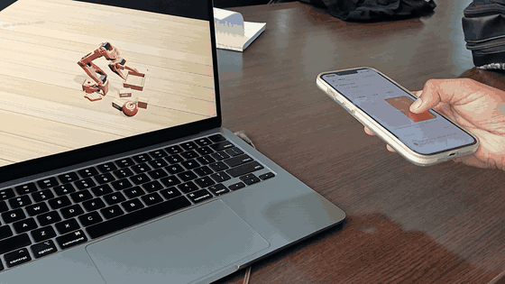
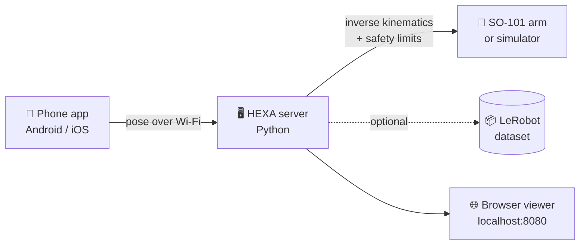
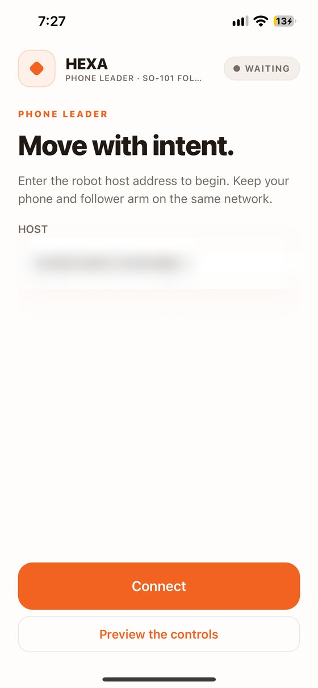
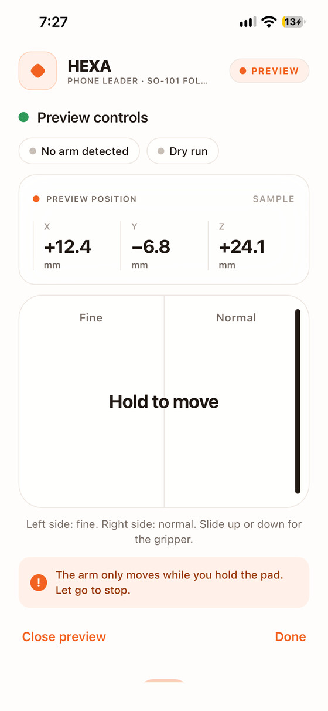
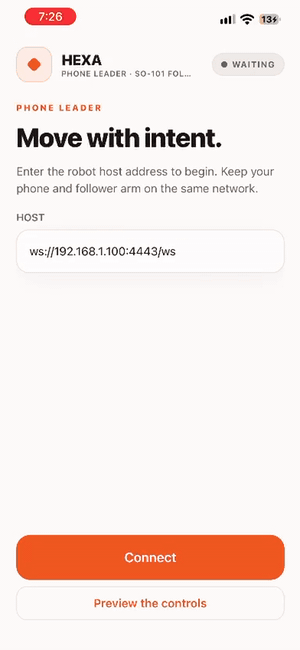
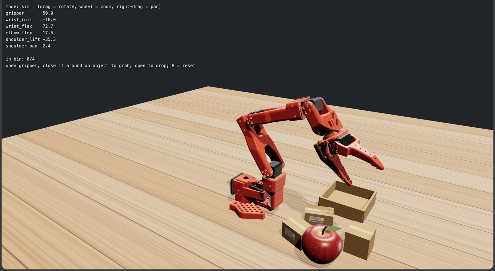

<div align="center">

# 📱 HEXA 🤖

### Your phone is the leader arm.

Hold your phone, move it through the air, and an **SO-101 robot arm** follows.
Record every move as a **LeRobot dataset** and train robot policies.


<br>



<sub>An iPhone driving the simulated arm. No leader arm, just a phone.</sub>

<br>

[✨ Features](#-features) • [⚙️ How it works](#️-how-it-works) • [🚀 Quick start](#-quick-start) • [🎥 Record data](#-record-demonstrations) • [🦾 Real arm](#-using-the-real-arm) • [🛡️ Safety](#️-safety)

</div>

---

## ✨ Features

| 📱 No leader arm | 🤖 Android + iPhone | 🧪 Simulator first | 📦 LeRobot-ready |
| :---: | :---: | :---: | :---: |
| Your phone is the controller | ARCore and ARKit, one server | Practise with zero risk | State, action, video, task |

## 💡 Why HEXA?

Teaching robots by demonstration needs **lots of good human examples**. The usual tool is a *leader arm*: a second robot you move by hand while the follower copies. It works, but it costs extra hardware and setup.

Everyone already carries a world-class 6-DoF tracker: **a phone**. HEXA turns it into the leader arm, so anyone with a phone and an SO-101 can start collecting robot data.

> 🎓 Built for research. HEXA is how our team drives the arm and gathers demonstration data.

## ⚙️ How it works



1. The phone tracks its own position and rotation.
2. It streams that pose to the server over your Wi-Fi.
3. The server converts the motion into SO-101 joint angles, with smoothing, speed limits and joint limits.
4. The arm moves, the viewer shows it live, and the recorder logs the episode.

## 📲 The app

<p align="center">
  
  &nbsp;&nbsp;
  
  &nbsp;&nbsp;
  
</p>

Connect to the server, then hold the pad to move. Left side is slow and precise, right side is normal speed, and sliding your thumb controls the gripper.

### 🧪 The simulator

<p align="center">
  
</p>

Open `localhost:8080` for live joint angles and a pick-and-place scene. Open the gripper, close it around an object to grab, open to drop, and press `R` to reset.

## 📦 What is inside

Unzip **`HEXA-Teleop.zip`** to get the **`EmberArm-Team`** folder:

| 📁 Item | 📝 What it is |
| --- | --- |
| `EmberArm-Final.apk` | Ready-to-install **Android** app |
| `PhoneTeleop.ipa` | Ready-to-sideload **iOS** app (appears as HEXA) |
| `server/` | Python host: kinematics, safety, robot control, recorder, viewer |
| `app-source/` | Phone app source (React Native + native ARCore / ARKit modules) |
| `FRIEND-SETUP.md` | One-page Windows quick start |

## 🚀 Quick start

> Start in the **simulator**. No arm needed, nothing can go wrong.

**You need:** Python 3.10+, an Android phone with ARCore or an iPhone with ARKit, and the phone and computer on the **same Wi-Fi**.

### 1️⃣ Unzip the project

```bash
unzip HEXA-Teleop.zip
cd EmberArm-Team/server
```

### 2️⃣ Start the server

```bash
chmod +x emberarm.sh
./emberarm.sh setup --no-lerobot
./emberarm.sh start --sim
```

On Windows use `emberarm.bat setup --no-lerobot` then `emberarm.bat start --sim`.

The server prints an address like `ws://192.168.x.x:4443/ws`. Copy it.

### 3️⃣ Install the phone app

<details>
<summary><b>🤖 Android</b></summary>

1. Copy `EmberArm-Final.apk` to the phone and tap it.
2. Allow **Install unknown apps** if asked.
3. If Play Protect warns you, tap **Install anyway**.
4. Open the app and allow **Camera**.
5. Install or update **Google Play Services for AR** if prompted.

</details>

<details>
<summary><b>🍎 iPhone</b></summary>

1. Install [Sideloadly](https://sideloadly.io) on a Mac or Windows PC.
2. Plug in the iPhone, drag `PhoneTeleop.ipa` into Sideloadly, sign in with your Apple ID and click **Start**.
3. On the phone: **Settings → General → VPN & Device Management** and trust your Apple ID.
4. On iOS 16+, enable **Developer Mode** if asked, then restart.
5. Open **HEXA** and allow **Camera**.

Free Apple IDs expire the app after 7 days. Just sideload again.

</details>

### 4️⃣ Connect and move

1. Enter the server address in the app and tap **Connect**.
2. Tap **Start tracking** and move the phone slowly over a bright, patterned surface until it says **Ready**.
3. Point the back camera toward the front of the robot and tap **Calibrate**.
4. **Hold your thumb on the pad to move.**

| 🎮 Control | 🦾 What it does |
| --- | --- |
| Hold the pad | Arm follows the phone |
| Left half of pad | Slow and precise |
| Right half of pad | Normal speed |
| Slide thumb up / down | Open / close the gripper |
| Let go | Arm stops, and the next press never jumps |

## 🎥 Record demonstrations

```bash
./emberarm.sh record --sim --max-speed 150
```

Add `--task "pick up the cube"` to label episodes. Data goes to `server/datasets/emberarm_demo`.

- ✅ With LeRobot installed you get a real **LeRobotDataset** (`observation.state`, `action`, video, task at 30 fps).
- 💾 Without it, episodes fall back to plain **NPZ** files so nothing is lost.

## 🦾 Using the real arm

> ⚠️ **The real arm moves for real.** Keep a hand near the power supply and move slowly.

```bash
./emberarm.sh setup         # installs LeRobot
./emberarm.sh calibrate     # move each joint through its full range once
./emberarm.sh start         # dry run, nothing moves
./emberarm.sh start --live  # drives the real arm
```

| 🚩 Flag | 🎯 When to use it |
| --- | --- |
| `--arm-port /dev/ttyACM0` (or `COM3`) | More than one USB device plugged in |
| `--id YOUR_NAME` | You named the arm differently when calibrating |
| `--roll-sign -1` | The wrist twists the wrong way |
| `--invert-gripper` | The gripper opens when it should close |
| `--max-speed N` | Joint speed cap in degrees per second |

## 🛡️ Safety

- 🟢 The arm only moves while you **hold the pad and tracking says Ready**.
- 🔌 Letting go, or losing Wi-Fi for 3 seconds, stops new commands.
- 🐢 Speed is capped and joints stay inside their allowed range.
- 🧑‍🔬 This is a lab tool, not a certified safety system. Stay close, go slow.

## 🧰 Troubleshooting

<details>
<summary><b>App can't connect</b></summary>

Keep the server window open, put phone and computer on the same Wi-Fi, and type the address exactly as printed. Office and guest Wi-Fi often block device-to-device traffic, so try a home router or phone hotspot. On Windows, allow ports 4443 and 8080 through the firewall.

</details>

<details>
<summary><b>Stuck on "Initializing" or "Tracking lost"</b></summary>

Face the back camera at a bright, patterned surface and move slowly. Blank walls and dark rooms don't work.

</details>

<details>
<summary><b>Movement is shaky or the arm goes the wrong way</b></summary>

Hold the phone with both hands and move steadily. Tap **Calibrate** again after tracking was lost.

</details>

<details>
<summary><b>"Phone went silent"</b></summary>

The phone stopped sending for 3 seconds (screen locked, app in background, Wi-Fi dropped). Keep the screen on and reconnect.

</details>

<details>
<summary><b>iPhone app stopped opening</b></summary>

Free-account signing expires after 7 days. Sideload again.

</details>

Check the server math with no phone or arm: `./emberarm.sh selftest` (should end with `URDF OK`).

## ✅ Tested on

| 📱 Device | Status |
| --- | --- |
| iPhone 13 (ARKit) | ✅ Works |
| Samsung Galaxy A35 (ARCore) | ✅ Works |
| Real SO-101 arm | ✅ Works |
| Simulator + browser viewer | ✅ Works |

## 🛠️ Tech stack

`React Native` · `Kotlin + ARCore` · `Swift + ARKit` · `Python` · `websockets` · `numpy` · `pyserial` · `LeRobot` · `SO-101 URDF` · `three.js`

## 🙏 Acknowledgments

Thanks to the **SO-101 / SO-ARM100** project, **Hugging Face LeRobot**, **onshape-to-robot**, **Google ARCore**, **Apple ARKit**, **React Native**, **three.js**, **websockets**, **NumPy** and **pySerial**.

## 📄 License

HEXA's code is released under the **MIT License** (see [LICENSE](LICENSE)). The SO-101 design files and third-party libraries keep their original licenses.

---

<div align="center">

### 👩‍💻 Built by

**Deepak** · **A M Likhitha** · **Chiranthan P**

If HEXA helps you collect data or learn robotics, a ⭐ is appreciated.

<sub>A research project by our team. Work in progress.</sub>

</div>