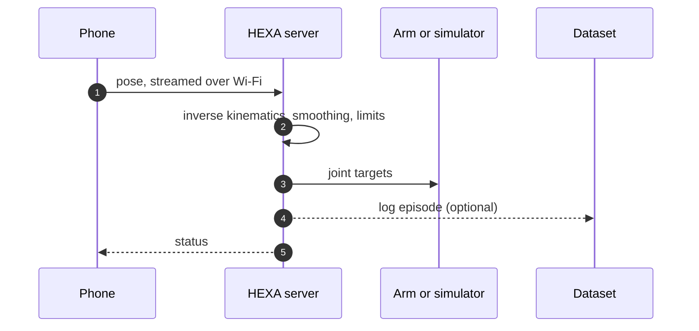

<div align="center">


<br><br>

# H E X A

### Wave your phone. Move a robot.

A pocket-sized teleoperation rig for the **SO-101 arm**, made by three students who wanted robot demonstration data without buying a second robot.

<br>


<br>

**[The pitch](#the-pitch)** &nbsp;|&nbsp; **[Under the hood](#under-the-hood)** &nbsp;|&nbsp; **[Get running](#get-running)** &nbsp;|&nbsp; **[Collect data](#collect-data)** &nbsp;|&nbsp; **[Real arm](#going-live-with-the-real-arm)** &nbsp;|&nbsp; **[FAQ](#faq)**

</div>

<br>

## The pitch

Robots learn from demonstrations, and demonstrations need a human to show the robot what to do. The standard way is a *leader arm*: a second robot you push around while the first one copies you.

We asked a simpler question: **what if the leader arm was already in your pocket?**

A phone knows exactly where it is and which way it is pointing. HEXA reads that, converts it into joint angles for the SO-101, and records everything in the format LeRobot expects. You hold the phone, the arm follows, and a training dataset quietly builds itself.

<br>

## At a glance

| | |
| :--- | :--- |
| **You move** | A phone (Android with ARCore, or iPhone with ARKit) |
| **It moves** | A real SO-101 arm, or a simulated one in your browser |
| **You get** | LeRobot-format episodes: state, action, camera video and task label |
| **Runs on** | A Python server on macOS, Ubuntu or Windows (via WSL2) |
| **Needs** | Phone and computer on the same Wi-Fi |

<br>

## Under the hood



Your phone tracks itself, the server turns that motion into safe joint commands, and the arm (or the simulator) carries them out. A browser viewer at `localhost:8080` shows the result live, and the recorder can save every episode as you go.

<br>

## See it in action

<p align="center">
  
  &nbsp;&nbsp;&nbsp;
  
  &nbsp;&nbsp;&nbsp;
  
</p>

<p align="center">
  
</p>

The viewer shows live joint angles and a small pick-and-place scene. Open the gripper, close it around an object to grab it, open it to drop, and press `R` to reset.

<br>

## Get running

Start in the simulator. There is nothing to break, and you learn the controls before touching real hardware.

> [!NOTE]
> You will need Python 3.10 or newer, a phone with ARCore or ARKit, and one Wi-Fi network shared by the phone and the computer.

**Step 1. Unpack and start the server**

```bash
unzip HEXA-Teleop.zip
cd EmberArm-Team/server
chmod +x emberarm.sh
./emberarm.sh setup --no-lerobot
./emberarm.sh start --sim
```

On Windows, run `emberarm.bat setup --no-lerobot` and then `emberarm.bat start --sim`.

The server prints an address like `ws://192.168.x.x:4443/ws`. Copy it.

**Step 2. Put the app on your phone**

<details>
<summary><b>Android</b></summary>
<br>

1. Copy `EmberArm-Final.apk` to the phone and tap it.
2. Allow **Install unknown apps** if asked, and choose **Install anyway** if Play Protect warns you.
3. Open the app and allow **Camera**.
4. Install or update **Google Play Services for AR** if it asks.

</details>

<details>
<summary><b>iPhone</b></summary>
<br>

1. Install [Sideloadly](https://sideloadly.io) on a Mac or Windows PC.
2. Plug in the iPhone, drag `PhoneTeleop.ipa` into Sideloadly, sign in with your Apple ID and press **Start**.
3. On the phone, trust your Apple ID under **Settings, General, VPN & Device Management**.
4. Turn on **Developer Mode** if iOS asks, then restart.
5. Open **HEXA** and allow **Camera**.

Free Apple IDs expire the app after 7 days. Sideload it again when that happens.

</details>

**Step 3. Connect, calibrate, move**

1. Type the server address into the app and tap **Connect**.
2. Tap **Start tracking** and sweep the phone slowly over a bright, patterned surface until it says **Ready**.
3. Point the back camera toward the front of the robot and tap **Calibrate**.
4. Put your thumb on the pad and move.

<br>

## Controls cheat sheet

| Gesture | Result |
| :--- | :--- |
| Hold the pad | The arm follows your phone |
| Left half of the pad | Fine mode: slow and precise |
| Right half of the pad | Normal speed |
| Slide thumb up or down | Open or close the gripper |
| Let go | The arm stops. The next press starts from where the arm is, so it never jumps |

<br>

## Collect data

```bash
./emberarm.sh record --sim --max-speed 150
```

Add `--task "pick up the cube"` to label your episodes. Recordings land in `server/datasets/emberarm_demo` (change it with `--dataset-dir`).

| If you have | You get |
| :--- | :--- |
| LeRobot installed | A proper **LeRobotDataset** at 30 fps: `observation.state`, `action`, video and task |
| No LeRobot | Plain **NPZ** files, so no demonstration is ever lost. Convert them later |

<br>

## Going live with the real arm

> [!WARNING]
> The real arm moves for real. Keep a hand near the power supply, move slowly, and support the arm before stopping the server. When the server stops, the motors switch off and the arm goes limp.

```bash
./emberarm.sh setup          # installs LeRobot (large download)
./emberarm.sh calibrate      # move every joint through its full range, once
./emberarm.sh start          # dry run: prints actions, nothing moves
./emberarm.sh start --live   # drives the real arm
```

| Flag | Use it when |
| :--- | :--- |
| `--arm-port /dev/ttyACM0` (or `COM3`) | More than one USB device is plugged in |
| `--id YOUR_NAME` | You gave the arm a custom name during calibration |
| `--roll-sign -1` | The wrist twists the wrong way |
| `--invert-gripper` | The gripper opens when it should close |
| `--max-speed N` | You want a joint speed cap in degrees per second |

On Ubuntu, if the USB port says "permission denied", run `sudo usermod -aG dialout $USER` and log in again.

<br>

## Safety built in

- The arm moves only while you **hold the pad** and tracking reads **Ready**.
- Letting go, closing the app, or 3 seconds without Wi-Fi stops new commands.
- Speed and joint ranges are capped in software.

> [!IMPORTANT]
> HEXA is a lab tool, not a certified safety system. Stay close and go slow.

<br>

## What is in the box

Unzip **`HEXA-Teleop.zip`** and you get a folder called **`EmberArm-Team`**:

| Item | Purpose |
| :--- | :--- |
| `EmberArm-Final.apk` | Android app, ready to install |
| `PhoneTeleop.ipa` | iPhone app, shows up as HEXA once sideloaded |
| `server/` | The Python host: kinematics, safety, robot control, recorder, browser viewer |
| `app-source/` | Phone app source: React Native with native ARCore and ARKit modules |
| `FRIEND-SETUP.md` | One-page Windows quick start |

**Rebuilding the apps** is only needed if you change `app-source/` (Node.js 22+). Android needs JDK 17 and the Android SDK (`./build-apk.sh`). iOS needs a Mac with Xcode (`npm install`, then `pod install` inside `ios/`).

<br>

## FAQ

<details>
<summary><b>Do I need a leader arm?</b></summary>
<br>
No. That is the whole point. Your phone is the leader.
</details>

<details>
<summary><b>Can I try it without the robot?</b></summary>
<br>
Yes. Use <code>start --sim</code> and watch the simulated arm at <code>localhost:8080</code>. You can also tap <b>Preview the controls</b> on the app's first screen to explore with no server at all.
</details>

<details>
<summary><b>The app cannot connect to the server</b></summary>
<br>
Keep the server window open, put both devices on the same Wi-Fi, and type the address exactly as printed. Office and guest networks often block device-to-device traffic, so try a home router or a phone hotspot. On Windows, allow ports 4443 and 8080 through the firewall. The address can change when Wi-Fi reconnects, so restart the server and copy the new one.
</details>

<details>
<summary><b>It says "Initializing" or "Tracking lost"</b></summary>
<br>
Point the back camera at a bright, patterned surface and move slowly. Blank walls and dark rooms confuse phone tracking. Tap <b>Calibrate</b> again after tracking returns.
</details>

<details>
<summary><b>The motion feels shaky</b></summary>
<br>
Hold the phone with both hands and move steadily. To compare against raw motion, start the server with <code>EMBERARM_SMOOTH=0</code>.
</details>

<details>
<summary><b>"Phone went silent"</b></summary>
<br>
The phone stopped sending for 3 seconds (screen locked, app in the background, or Wi-Fi dropped). Keep the screen on and reconnect.
</details>

<details>
<summary><b>How do I check the server maths without any hardware?</b></summary>
<br>
Run <code>./emberarm.sh selftest</code>. It should finish with <code>URDF OK</code>.
</details>

<br>

## Tested on

| Hardware | Result |
| :--- | :---: |
| iPhone 13 (ARKit) | Works |
| Samsung Galaxy A35 (ARCore) | Works |
| Real SO-101 arm | Works |
| Simulator and browser viewer | Works |
| Server on macOS | Built and tested here |
| Server on Ubuntu or Windows (WSL2) | Same code, should work. Reports welcome |

Other ARKit or ARCore phones should work too.

<br>

## Built with

React Native, Kotlin and ARCore, Swift and ARKit, Python (`websockets`, `numpy`, `pyserial`), LeRobot, the SO-101 URDF, and three.js for the viewer.

<br>

## Team

<div align="center">

**Deepak** &nbsp;&middot;&nbsp; **A M Likhitha** &nbsp;&middot;&nbsp; **Chiranthan P**

*Three students, one phone, one robot arm.*

</div>

<br>

## Thanks and license

HEXA stands on open-source shoulders: the **SO-101 / SO-ARM100** design by TheRobotStudio and Hugging Face, **LeRobot**, **onshape-to-robot**, **Google ARCore**, **Apple ARKit**, **React Native** and **three.js**.

HEXA's own code is released under the [MIT License](LICENSE). The SO-101 design files and third-party libraries keep their original licenses.

<div align="center">

<br>

If HEXA helps your research or your weekend project, a star is appreciated.

<sub>A research project, still a work in progress.</sub>

</div>