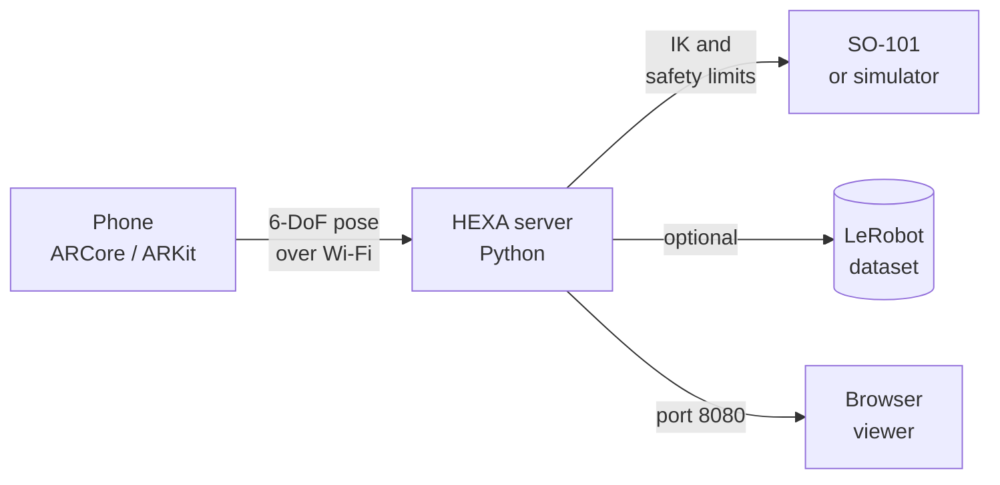

<div align="center">

# HEXA

**Teleoperate a robot arm with your phone.**

A phone-driven control and data-collection system for the SO-101 robot arm.<br>
Move the phone, the arm follows, and every demonstration is recorded in LeRobot format.

<br>


<br>
<br>

`Android` &nbsp;·&nbsp; `iOS` &nbsp;·&nbsp; `Python 3.10+` &nbsp;·&nbsp; `SO-101` &nbsp;·&nbsp; `LeRobot` &nbsp;·&nbsp; `MIT`

<br>

[Overview](#overview) &nbsp;|&nbsp; [Architecture](#architecture) &nbsp;|&nbsp; [Getting started](#getting-started) &nbsp;|&nbsp; [Recording](#recording-demonstrations) &nbsp;|&nbsp; [Hardware](#running-on-hardware) &nbsp;|&nbsp; [Troubleshooting](#troubleshooting)

</div>

<br>

## Overview

Learning from demonstration needs many examples of a human performing a task. The common way to gather them is a leader arm, a second robot that a person moves while the follower copies it. That means extra hardware, extra wiring and extra cost.

HEXA removes the second arm. The motion sensors already inside a phone give a precise 6-DoF pose, and HEXA turns that pose into joint commands for the SO-101. The same session can be logged as a dataset, ready for training policies such as ACT and SmolVLA.

HEXA is open source, was built by students, and is used in our own research on vision-language-action models.

<br>

## Highlights

|  |  |
| :--- | :--- |
| **No leader arm** | The phone is the controller |
| **Two platforms** | ARCore on Android, ARKit on iOS, one shared server |
| **Simulator included** | Practise in the browser before the real arm moves |
| **Training-ready data** | State, action, camera video and task label per episode |
| **Built-in safety** | Speed caps, joint limits and a hold-to-move control |

<br>

## Architecture



The phone tracks its own pose and streams it over your local network. The server applies inverse kinematics with smoothing, speed limits and joint limits, then drives the arm or simulator. The browser viewer mirrors the motion live, and the recorder logs the episode when enabled.

<br>

## Interface

<table align="center">
  <tr>
    <td align="center"></td>
    <td align="center"></td>
    <td align="center"></td>
  </tr>
  <tr>
    <td align="center"><sub>Connect</sub></td>
    <td align="center"><sub>Control pad</sub></td>
    <td align="center"><sub>Walkthrough</sub></td>
  </tr>
</table>

<p align="center">
  <br>
  <sub>Browser viewer at <code>localhost:8080</code>: live joint angles and a pick-and-place scene.</sub>
</p>

<br>

## Getting started

Begin in the simulator. No arm is needed and nothing can be damaged.

**Requirements:** Python 3.10 or newer, an Android phone with ARCore or an iPhone with ARKit, and the phone and computer on the same Wi-Fi.

### 1. Start the server

```bash
unzip HEXA-Teleop.zip
cd EmberArm-Team/server
chmod +x emberarm.sh
./emberarm.sh setup --no-lerobot
./emberarm.sh start --sim
```

On Windows, use `emberarm.bat setup --no-lerobot`, then `emberarm.bat start --sim`.

The server prints an address such as `ws://192.168.x.x:4443/ws`. Keep it handy.

### 2. Install the app

<details>
<summary><b>Android</b></summary>
<br>

1. Copy `EmberArm-Final.apk` to the phone and open it.
2. Allow **Install unknown apps**. If Play Protect warns you, choose **Install anyway**.
3. Open the app and grant **Camera** access.
4. Install or update **Google Play Services for AR** if prompted.

</details>

<details>
<summary><b>iPhone</b></summary>
<br>

1. Install [Sideloadly](https://sideloadly.io) on a Mac or Windows PC.
2. Connect the iPhone, drag `PhoneTeleop.ipa` into Sideloadly, sign in with your Apple ID and select **Start**.
3. On the phone, trust your Apple ID under **Settings > General > VPN & Device Management**.
4. Enable **Developer Mode** if asked, then restart.
5. Open **HEXA** and grant **Camera** access.

Free Apple ID signing expires after 7 days. Sideload again when it does.

</details>

### 3. Connect and calibrate

1. Enter the server address in the app and tap **Connect**.
2. Tap **Start tracking** and move the phone slowly over a bright, textured surface until it shows **Ready**.
3. Point the back camera toward the front of the robot and tap **Calibrate**.
4. Hold the pad to move.

<br>

## Controls

| Input | Effect |
| :--- | :--- |
| Hold the pad | The arm follows the phone |
| Left half of the pad | Fine mode, slow and precise |
| Right half of the pad | Normal speed |
| Slide thumb up or down | Open or close the gripper |
| Release | The arm stops. The next press starts from the arm's current pose, so it never jumps |

<br>

## Recording demonstrations

```bash
./emberarm.sh record --sim --max-speed 150
```

Add `--task "pick up the cube"` to label episodes. Data is saved to `server/datasets/emberarm_demo`; change it with `--dataset-dir`.

| Setup | Output |
| :--- | :--- |
| LeRobot installed | LeRobotDataset at 30 fps: `observation.state`, `action`, camera video, task |
| LeRobot not installed | Plain NPZ files, so nothing is lost. Convert them later |

<br>

## Running on hardware

> [!WARNING]
> ⚠️ The real arm moves. Keep a hand near the power supply, move slowly, and support the arm before stopping the server. When the server stops, the motors switch off and the arm goes limp.

```bash
./emberarm.sh setup          # installs LeRobot (large download)
./emberarm.sh calibrate      # move each joint through its full range, once
./emberarm.sh start          # dry run: prints actions, nothing moves
./emberarm.sh start --live   # drives the real arm
```

<details>
<summary><b>Command-line flags</b></summary>
<br>

| Flag | Use when |
| :--- | :--- |
| `--arm-port /dev/ttyACM0` (or `COM3`) | More than one USB device is connected |
| `--id YOUR_NAME` | The arm was given a custom name during calibration |
| `--roll-sign -1` | The wrist rotates the wrong way |
| `--invert-gripper` | The gripper opens when it should close |
| `--max-speed N` | You need a joint speed cap in degrees per second |

On Ubuntu, if the serial port reports "permission denied", run `sudo usermod -aG dialout $USER` and log in again.

</details>

<br>

## Safety

- The arm moves only while the pad is held and tracking reports **Ready**.
- Releasing the pad, closing the app, or 3 seconds without Wi-Fi stops new commands.
- Speed and joint ranges are limited in software.

> [!IMPORTANT]
> HEXA is a laboratory tool, not a certified safety system. Stay close to the arm and move slowly.

<br>

## Project layout

Unzip `HEXA-Teleop.zip` to get the `EmberArm-Team` folder:

| Path | Contents |
| :--- | :--- |
| `EmberArm-Final.apk` | Android app, ready to install |
| `PhoneTeleop.ipa` | iOS app, appears as HEXA once sideloaded |
| `server/` | Python host: kinematics, safety, robot control, recorder, browser viewer |
| `app-source/` | Phone app source: React Native with native ARCore and ARKit modules |
| `FRIEND-SETUP.md` | One-page Windows quick start |

To rebuild the apps after changing `app-source/`, you need Node.js 22+. Android also needs JDK 17 and the Android SDK (`./build-apk.sh`). iOS needs a Mac with Xcode (`npm install`, then `pod install` inside `ios/`).

<br>

## Troubleshooting

| Symptom | What to try |
| :--- | :--- |
| App cannot connect | Keep the server running and both devices on the same Wi-Fi. Enter the address exactly as printed. Office and guest networks often block device-to-device traffic, so try a home router or phone hotspot. On Windows, allow ports 4443 and 8080 through the firewall |
| Address stopped working | It can change when Wi-Fi reconnects. Restart the server and copy the new one |
| "Initializing" or "Tracking lost" | Point the back camera at a bright, patterned surface and move slowly. Blank walls and dim rooms degrade tracking |
| Motion is shaky | Hold the phone with both hands. To compare with raw motion, start the server with `EMBERARM_SMOOTH=0` |
| Arm moves the wrong way | Tap **Calibrate** again after tracking was lost |
| "Phone went silent" | The phone stopped sending for 3 seconds (screen locked, app in background, Wi-Fi dropped). Keep the screen on and reconnect |
| iPhone app no longer opens | Free-account signing expired after 7 days. Sideload again |

To check the kinematics with no phone or arm, run `./emberarm.sh selftest`. It should finish with `URDF OK`.

<br>

## Status

| Configuration | Result |
| :--- | :---: |
| iPhone 13 (ARKit) | Verified |
| Samsung Galaxy A35 (ARCore) | Verified |
| Real SO-101 arm | Verified |
| Simulator and browser viewer | Verified |
| Server on macOS | Verified |
| Server on Ubuntu or Windows (WSL2) | Same code, expected to work |

HEXA is a work in progress. We are now experimenting with ACT and SmolVLA and moving toward deployment on an NVIDIA Jetson Orin Nano. Bug reports and feedback are welcome.

<br>

## Team

<div align="center">

**Deepak K** &nbsp;·&nbsp; **A M Likhitha** &nbsp;·&nbsp; **Chiranthan P**

</div>

<br>

## Acknowledgments

HEXA builds on the SO-101 / SO-ARM100 design by TheRobotStudio and Hugging Face, LeRobot, onshape-to-robot, Google ARCore, Apple ARKit, React Native and three.js.

## License

HEXA's code is released under the [MIT License](LICENSE). The SO-101 design files and third-party libraries keep their original licenses.