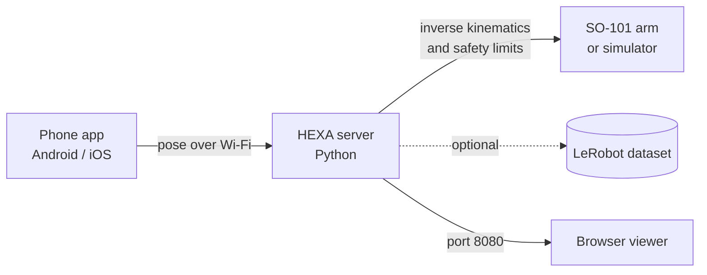

<div align="center">

# HEXA

**Phone-based teleoperation for the SO-101 robot arm**

Move your phone, and the arm follows. Every motion can be recorded as a LeRobot dataset.

<br>


<br>


<sub>An iPhone driving the simulated arm. No leader arm required.</sub>

<br>

[Overview](#overview) · [Architecture](#architecture) · [Quick start](#quick-start) · [Data collection](#data-collection) · [Real hardware](#real-hardware) · [Safety](#safety) · [FAQ](#faq)

</div>

---

## Overview

Imitation learning depends on large numbers of good human demonstrations. The usual way to collect them is a leader arm: a second robot that a person moves while the follower copies. It works well, but it adds hardware, wiring and cost.

HEXA replaces the leader arm with a device most people already own. A phone's built-in motion tracking (ARCore on Android, ARKit on iOS) is streamed to a Python server, converted into joint commands for the SO-101, and optionally logged as a LeRobot dataset.

| | |
| :--- | :--- |
| **Input** | A phone running ARCore (Android) or ARKit (iOS) |
| **Output** | A real SO-101 arm, or a simulated arm in the browser |
| **Data** | LeRobot-format episodes: state, action, camera video, task label |
| **Server** | Python on macOS, Ubuntu, or Windows (WSL2) |
| **Network** | Phone and computer on the same Wi-Fi |

---

## Architecture



1. The phone tracks its own position and rotation.
2. The pose is streamed to the server over the local network.
3. The server converts it to SO-101 joint angles, applying smoothing, speed limits and joint limits.
4. The arm or simulator moves, the viewer displays it, and the recorder logs the episode if enabled.

---

## Interface

<p align="center">
  
  &nbsp;&nbsp;&nbsp;&nbsp;
  
  &nbsp;&nbsp;&nbsp;&nbsp;
  
</p>

<p align="center">
  
</p>

The browser viewer at `localhost:8080` shows live joint angles and a pick-and-place scene. Open the gripper, close it around an object to grab it, open it to release, and press `R` to reset.

---

## Quick start

Begin with the simulator. No arm is required and nothing can be damaged.

**Requirements**

- Python 3.10 or newer
- An Android phone with ARCore, or an iPhone with ARKit
- Phone and computer on the same Wi-Fi network

### 1. Start the server

```bash
unzip HEXA-Teleop.zip
cd EmberArm-Team/server
chmod +x emberarm.sh
./emberarm.sh setup --no-lerobot
./emberarm.sh start --sim
```

On Windows, use `emberarm.bat setup --no-lerobot` followed by `emberarm.bat start --sim`.

The server prints an address such as `ws://192.168.x.x:4443/ws`. Copy it for the next steps.

### 2. Install the phone app

<details>
<summary><b>Android</b></summary>
<br>

1. Copy `EmberArm-Final.apk` to the phone and open it.
2. Allow **Install unknown apps** when prompted. If Play Protect warns you, choose **Install anyway**.
3. Open the app and grant **Camera** permission.
4. Install or update **Google Play Services for AR** if requested.

</details>

<details>
<summary><b>iPhone</b></summary>
<br>

1. Install [Sideloadly](https://sideloadly.io) on a Mac or Windows PC.
2. Connect the iPhone, drag `PhoneTeleop.ipa` into Sideloadly, sign in with your Apple ID and select **Start**.
3. On the phone, trust your Apple ID under **Settings > General > VPN & Device Management**.
4. Enable **Developer Mode** if prompted, then restart the device.
5. Open **HEXA** and grant **Camera** permission.

Free Apple ID signing expires after 7 days. Sideload the app again when that happens.

</details>

### 3. Connect and calibrate

1. Enter the server address in the app and tap **Connect**.
2. Tap **Start tracking** and move the phone slowly over a bright, patterned surface until the status reads **Ready**.
3. Point the back camera toward the front of the robot and tap **Calibrate**.
4. Hold the pad to move.

### Controls

| Input | Behavior |
| :--- | :--- |
| Hold the pad | The arm follows the phone |
| Left half of the pad | Fine mode: slow and precise |
| Right half of the pad | Normal speed |
| Slide thumb up or down | Open or close the gripper |
| Release | The arm stops. The next press starts from the arm's current pose, so it never jumps |

---

## Data collection

```bash
./emberarm.sh record --sim --max-speed 150
```

Add `--task "pick up the cube"` to label episodes. Data is written to `server/datasets/emberarm_demo` by default; use `--dataset-dir` to change this.

| Environment | Output |
| :--- | :--- |
| LeRobot installed | A LeRobotDataset at 30 fps with `observation.state`, `action`, camera video and task |
| LeRobot not installed | Plain NPZ files, so no demonstration is lost. These can be converted later |

---

## Real hardware

> [!WARNING]
> The real arm moves. Keep a hand near the power supply, move slowly, and support the arm before stopping the server. When the server stops, the motors switch off and the arm goes limp.

```bash
./emberarm.sh setup          # installs LeRobot (large download)
./emberarm.sh calibrate      # move each joint through its full range, once
./emberarm.sh start          # dry run: prints actions, nothing moves
./emberarm.sh start --live   # drives the real arm
```

| Flag | Use when |
| :--- | :--- |
| `--arm-port /dev/ttyACM0` (or `COM3`) | More than one USB device is connected |
| `--id YOUR_NAME` | The arm was given a custom name during calibration |
| `--roll-sign -1` | The wrist rotates in the wrong direction |
| `--invert-gripper` | The gripper opens when it should close |
| `--max-speed N` | A joint speed cap in degrees per second is needed |

On Ubuntu, if the serial port reports "permission denied", run `sudo usermod -aG dialout $USER` and log in again.

---

## Safety

- The arm moves only while the pad is held and tracking reports Ready.
- Releasing the pad, closing the app, or losing Wi-Fi for 3 seconds stops new commands.
- Speed and joint ranges are limited in software.

> [!IMPORTANT]
> HEXA is a laboratory tool, not a certified safety system. Stay close to the arm and move slowly.

---

## Repository contents

Unzip `HEXA-Teleop.zip` to obtain the `EmberArm-Team` folder:

| Item | Description |
| :--- | :--- |
| `EmberArm-Final.apk` | Android app, ready to install |
| `PhoneTeleop.ipa` | iOS app, appears as HEXA once sideloaded |
| `server/` | Python host: kinematics, safety, robot control, recorder, browser viewer |
| `app-source/` | Phone app source: React Native with native ARCore and ARKit modules |
| `FRIEND-SETUP.md` | One-page Windows quick start |

**Rebuilding the apps** is only necessary after changing `app-source/` and requires Node.js 22+. Android additionally needs JDK 17 and the Android SDK (`./build-apk.sh`). iOS needs a Mac with Xcode (`npm install`, then `pod install` inside `ios/`).

---

## FAQ

<details>
<summary><b>Is a leader arm required?</b></summary>
<br>
No. The phone replaces it.
</details>

<details>
<summary><b>Can I try HEXA without a robot?</b></summary>
<br>
Yes. Run <code>start --sim</code> and open <code>localhost:8080</code>. You can also tap <b>Preview the controls</b> on the app's first screen to explore without a server.
</details>

<details>
<summary><b>The app cannot connect to the server</b></summary>
<br>
Keep the server running, ensure both devices are on the same Wi-Fi, and enter the address exactly as printed. Office and guest networks often block device-to-device traffic; try a home router or a phone hotspot. On Windows, allow ports 4443 and 8080 through the firewall. The address can change when Wi-Fi reconnects, so restart the server and copy the new one.
</details>

<details>
<summary><b>The status shows "Initializing" or "Tracking lost"</b></summary>
<br>
Point the back camera at a bright, patterned surface and move slowly. Blank walls and dim rooms degrade phone tracking. Tap <b>Calibrate</b> again once tracking returns.
</details>

<details>
<summary><b>Motion appears shaky</b></summary>
<br>
Hold the phone with both hands and move steadily. To compare against unsmoothed motion, start the server with <code>EMBERARM_SMOOTH=0</code>.
</details>

<details>
<summary><b>The server reports "Phone went silent"</b></summary>
<br>
The phone stopped sending for 3 seconds because the screen locked, the app moved to the background, or Wi-Fi dropped. Keep the screen on and reconnect.
</details>

<details>
<summary><b>How can I verify the kinematics without hardware?</b></summary>
<br>
Run <code>./emberarm.sh selftest</code>. It should finish with <code>URDF OK</code>.
</details>

---

## Tested configurations

| Configuration | Status |
| :--- | :---: |
| iPhone 13 (ARKit) | Verified |
| Samsung Galaxy A35 (ARCore) | Verified |
| Real SO-101 arm | Verified |
| Simulator and browser viewer | Verified |
| Server on macOS | Verified |
| Server on Ubuntu or Windows (WSL2) | Same code, expected to work |

Other ARKit and ARCore devices should also work.

---

## Technology

React Native · Kotlin and ARCore · Swift and ARKit · Python (`websockets`, `numpy`, `pyserial`) · LeRobot · SO-101 URDF · three.js

---

## Team

**Deepak** · **A M Likhitha** · **Chiranthan P**

Developed as part of our robotics research work.

---

## Acknowledgments

HEXA builds on the SO-101 / SO-ARM100 design by TheRobotStudio and Hugging Face, LeRobot, onshape-to-robot, Google ARCore, Apple ARKit, React Native and three.js.

## License

HEXA's code is released under the [MIT License](LICENSE). The SO-101 design files and third-party libraries retain their original licenses.