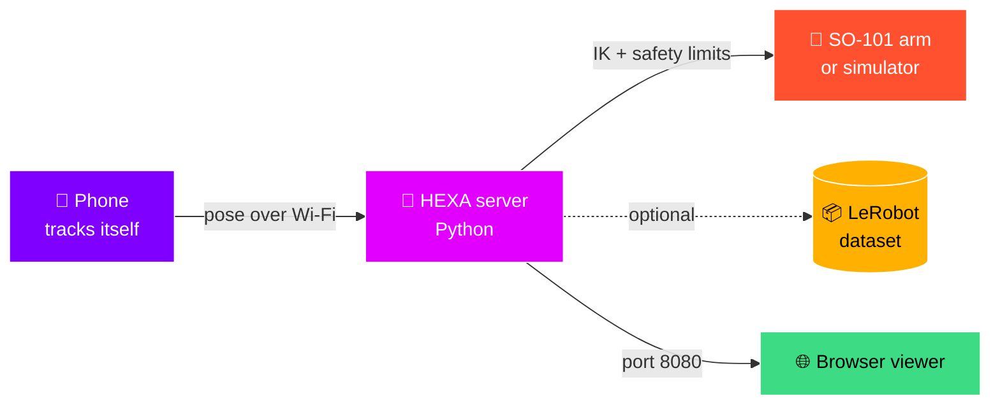

<div align="center">


<a href="https://github.com/amlikhitha333/Hexa666">
  
</a>

<br><br>


<br><br>


<br>

**[💡 Pitch](#-the-pitch)** &nbsp;•&nbsp; **[🧠 How it works](#-how-it-works)** &nbsp;•&nbsp; **[🚀 Get running](#-get-running)** &nbsp;•&nbsp; **[🎥 Data](#-collect-data)** &nbsp;•&nbsp; **[🦾 Real arm](#-going-live-with-the-real-arm)** &nbsp;•&nbsp; **[❓ FAQ](#-faq)**

</div>

<br>

## 💡 The pitch

🤖 Robots learn by watching humans do the task. The usual way to teach them is a **leader arm**: a second robot you push around while the first one copies you.

📱 We asked a silly question: **what if the leader arm was already in your pocket?**

Your phone knows exactly where it is and which way it points. **HEXA** reads that, turns it into joint angles for the SO-101, and saves everything in the format LeRobot loves. You hold the phone ➜ the arm follows ➜ a training dataset builds itself. ✨

<br>

## ⚡ At a glance

| 🎯 | What |
| :---: | :--- |
| 📱 | **You move** a phone (Android with ARCore, or iPhone with ARKit) |
| 🦾 | **It moves** a real SO-101 arm, or a simulated one in your browser |
| 📦 | **You get** LeRobot episodes: state, action, camera video and task label |
| 💻 | **Runs on** a Python server (macOS, Ubuntu, Windows via WSL2) |
| 📶 | **Needs** phone and computer on the same Wi-Fi |

<br>

## 🧠 How it works



1. 📍 The phone tracks its own position and rotation.
2. 📡 It streams the pose to the server over your Wi-Fi.
3. 🧮 The server converts it into joint angles with smoothing, speed limits and joint limits.
4. 🦾 The arm moves, 🌐 the viewer shows it live, and 🎥 the recorder logs the episode.

<br>

## 📸 See it in action

<p align="center">
  
  &nbsp;&nbsp;&nbsp;
  
  &nbsp;&nbsp;&nbsp;
  
</p>

<p align="center">
  
</p>

🎮 The viewer shows live joint angles and a mini pick-and-place scene. Open the gripper ➜ close it around an object to grab ➜ open to drop ➜ press `R` to reset.

<br>

## 🚀 Get running

🧪 Start in the **simulator**. Nothing can break, and you learn the controls before touching real hardware.

> [!NOTE]
> 🐍 You need **Python 3.10+**, a phone with **ARCore or ARKit**, and **one shared Wi-Fi** for the phone and the computer.

### 1️⃣ Unpack and start the server 🖥️

```bash
unzip HEXA-Teleop.zip
cd EmberArm-Team/server
chmod +x emberarm.sh
./emberarm.sh setup --no-lerobot
./emberarm.sh start --sim
```

🪟 On Windows: `emberarm.bat setup --no-lerobot` then `emberarm.bat start --sim`.

The server prints an address like `ws://192.168.x.x:4443/ws`. 📋 Copy it!

### 2️⃣ Put the app on your phone 📲

<details>
<summary><b>🤖 Android</b></summary>
<br>

1. 📂 Copy `EmberArm-Final.apk` to the phone and tap it.
2. ✅ Allow **Install unknown apps**, and tap **Install anyway** if Play Protect complains.
3. 📷 Open the app and allow **Camera**.
4. 🧩 Install or update **Google Play Services for AR** if asked.

</details>

<details>
<summary><b>🍎 iPhone</b></summary>
<br>

1. 🛠️ Install [Sideloadly](https://sideloadly.io) on a Mac or Windows PC.
2. 🔌 Plug in the iPhone, drag `PhoneTeleop.ipa` into Sideloadly, sign in with your Apple ID and press **Start**.
3. 🔐 On the phone: **Settings → General → VPN & Device Management** and trust your Apple ID.
4. 🧑‍💻 Turn on **Developer Mode** if iOS asks, then restart.
5. 📷 Open **HEXA** and allow **Camera**.

⏳ Free Apple IDs expire the app after 7 days. Just sideload again.

</details>

### 3️⃣ Connect, calibrate, move 🎮

1. 🔗 Type the server address into the app and tap **Connect**.
2. 👀 Tap **Start tracking** and sweep the phone slowly over a bright, patterned surface until it says **Ready**.
3. 🎯 Point the back camera toward the front of the robot and tap **Calibrate**.
4. 👍 Put your thumb on the pad and move!

<br>

## 🎮 Controls cheat sheet

| 🕹️ Gesture | ✨ Result |
| :--- | :--- |
| 👍 Hold the pad | The arm follows your phone |
| ⬅️ Left half of the pad | 🐢 Fine mode: slow and precise |
| ➡️ Right half of the pad | 🐇 Normal speed |
| ↕️ Slide thumb up or down | 🤏 Open or close the gripper |
| ✋ Let go | 🛑 The arm stops. Next press starts where the arm is, so it never jumps |

<br>

## 🎥 Collect data

```bash
./emberarm.sh record --sim --max-speed 150
```

🏷️ Add `--task "pick up the cube"` to label episodes. Data lands in `server/datasets/emberarm_demo` (change with `--dataset-dir`).

| 🧰 If you have | 🎁 You get |
| :--- | :--- |
| 🤗 LeRobot installed | A proper **LeRobotDataset** at 30 fps: `observation.state`, `action`, video and task |
| 💾 No LeRobot | Plain **NPZ** files, so no demo is ever lost. Convert later |

<br>

## 🦾 Going live with the real arm

> [!WARNING]
> ⚠️ **The real arm moves for real!** Keep a hand near the power supply, move slowly, and support the arm before stopping the server. When the server stops, the motors switch off and the arm goes limp.

```bash
./emberarm.sh setup          # 📥 installs LeRobot (large download)
./emberarm.sh calibrate      # 🔧 move every joint through its full range, once
./emberarm.sh start          # 🧪 dry run: prints actions, nothing moves
./emberarm.sh start --live   # 🔥 drives the real arm
```

| 🚩 Flag | 🎯 Use it when |
| :--- | :--- |
| `--arm-port /dev/ttyACM0` (or `COM3`) | 🔌 More than one USB device is plugged in |
| `--id YOUR_NAME` | 🏷️ You named the arm during calibration |
| `--roll-sign -1` | 🔄 The wrist twists the wrong way |
| `--invert-gripper` | 🤏 The gripper opens when it should close |
| `--max-speed N` | 🐢 Joint speed cap in degrees per second |

🐧 On Ubuntu, if the USB port says "permission denied": `sudo usermod -aG dialout $USER`, then log in again.

<br>

## 🛡️ Safety built in

- 🟢 The arm moves only while you **hold the pad** and tracking says **Ready**.
- 📴 Letting go, closing the app, or 3 seconds of lost Wi-Fi stops new commands.
- 🐢 Speed and joint ranges are capped in software.

> [!IMPORTANT]
> 🧑‍🔬 HEXA is a lab tool, not a certified safety system. Stay close, go slow.

<br>

## 📦 What is in the box

Unzip **`HEXA-Teleop.zip`** to get a folder called **`EmberArm-Team`**:

| 📁 Item | 📝 What it is |
| :--- | :--- |
| 🤖 `EmberArm-Final.apk` | Android app, ready to install |
| 🍎 `PhoneTeleop.ipa` | iPhone app, shows up as HEXA once sideloaded |
| 🖥️ `server/` | Python host: kinematics, safety, robot control, recorder, viewer |
| 📲 `app-source/` | Phone app source (React Native + native ARCore and ARKit modules) |
| 📄 `FRIEND-SETUP.md` | One-page Windows quick start |

🔨 **Rebuilding the apps** is only needed if you change `app-source/` (Node.js 22+). Android needs JDK 17 and the Android SDK (`./build-apk.sh`). iOS needs a Mac with Xcode (`npm install`, then `pod install` inside `ios/`).

<br>

## ❓ FAQ

<details>
<summary><b>🤔 Do I need a leader arm?</b></summary>
<br>
Nope! That is the whole point. Your phone is the leader. 📱
</details>

<details>
<summary><b>🧪 Can I try it without the robot?</b></summary>
<br>
Yes! Use <code>start --sim</code> and watch the simulated arm at <code>localhost:8080</code>. You can also tap <b>Preview the controls</b> on the app's first screen to explore with no server at all.
</details>

<details>
<summary><b>📶 The app can't connect</b></summary>
<br>
Keep the server window open, use the same Wi-Fi on both devices, and type the address exactly as printed. Office and guest Wi-Fi often block device-to-device traffic, so try a home router or phone hotspot. On Windows, allow ports 4443 and 8080 through the firewall. The address can change when Wi-Fi reconnects, so restart the server and copy the new one.
</details>

<details>
<summary><b>👀 "Initializing" or "Tracking lost"</b></summary>
<br>
Point the back camera at a bright, patterned surface and move slowly. Blank walls and dark rooms confuse phone tracking. Tap <b>Calibrate</b> again after tracking returns.
</details>

<details>
<summary><b>🫨 The motion feels shaky</b></summary>
<br>
Hold the phone with both hands and move steadily. To compare with raw motion, start the server with <code>EMBERARM_SMOOTH=0</code>.
</details>

<details>
<summary><b>🔇 "Phone went silent"</b></summary>
<br>
The phone stopped sending for 3 seconds (screen locked, app in background, or Wi-Fi dropped). Keep the screen on and reconnect.
</details>

<details>
<summary><b>🧮 How do I check the maths with no hardware?</b></summary>
<br>
Run <code>./emberarm.sh selftest</code>. It should finish with <code>URDF OK</code>. ✅
</details>

<br>

## ✅ Tested on

| 📱 Hardware | 🏁 Result |
| :--- | :---: |
| iPhone 13 (ARKit) | ✅ Works |
| Samsung Galaxy A35 (ARCore) | ✅ Works |
| Real SO-101 arm | ✅ Works |
| Simulator + browser viewer | ✅ Works |
| Server on macOS | ✅ Built and tested here |
| Server on Ubuntu / Windows (WSL2) | 🟡 Same code, should work. Reports welcome |

📲 Other ARKit or ARCore phones should work too!

<br>

## 🧰 Built with


<br>

## 👩‍💻 Team

<div align="center">

### 🚀 **Deepak** &nbsp;•&nbsp; 💜 **A M Likhitha** &nbsp;•&nbsp; 🤖 **Chiranthan P**

*Three students. One phone. One robot arm.* ✨

</div>

<br>

## 🙏 Thanks and license

HEXA stands on open-source shoulders: **SO-101 / SO-ARM100** by TheRobotStudio and Hugging Face, **LeRobot**, **onshape-to-robot**, **Google ARCore**, **Apple ARKit**, **React Native** and **three.js**. 💖

📄 HEXA's own code is released under the [MIT License](LICENSE). The SO-101 design files and third-party libraries keep their original licenses.

<div align="center">

<br>

⭐ **If HEXA helps your research or your weekend project, drop a star!** ⭐

<sub>🔬 A research project, still a work in progress.</sub>


</div>